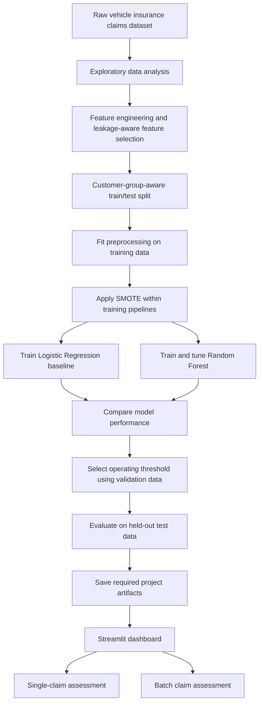

# Vehicle Insurance Claim Fraud Risk Classification System

A machine-learning decision-support dashboard for identifying vehicle insurance claims that may warrant further fraud investigation. The system compares Logistic Regression and a tuned Random Forest model, then provides an interactive Streamlit interface for assessing individual claims and ranking batches of claims by model score.

> **Important:** This project is an investigation-prioritization aid, not an automated fraud detector. A high score is not proof of fraud. All flagged claims require human review.

## Project Overview

This project explores how supervised machine learning can help investigators prioritize vehicle insurance claims for review. It uses the Kaggle **Vehicle Insurance Claim Fraud Detection Dataset** and includes exploratory data analysis, leakage-aware preprocessing, class-imbalance handling, model comparison, hyperparameter tuning, threshold selection, evaluation, and a Streamlit dashboard.

## Prerequisites

Make sure the following are available before installing or running the project:

- **Python 3:** Install a Python version compatible with the packages listed in `requirements.txt`.
- **pip:** Python package installer, used to install the project dependencies.
- **Git:** Required to clone the project repository.
- **Kaggle account and internet connection:** Required to download the dataset if it is not already available locally.
- **Project files and generated artifacts:** The dashboard requires the preprocessing and model artifacts described in the [Repository Structure](#repository-structure) and [Installation and Execution](#installation-and-execution) sections.

You can check whether Python, pip, and Git are available by running:

```powershell
python --version
python -m pip --version
git --version
```

## Key Features

- Exploratory data analysis and feature engineering.
- Leakage-aware feature selection.
- Customer-group-aware train/test splitting.
- Numerical imputation and categorical one-hot encoding.
- SMOTE applied within model-training pipelines.
- Logistic Regression baseline and Grid-Search-tuned Random Forest.
- Evaluation using precision, recall, F1-score, ROC-AUC, and PR-AUC.
- Validation-based decision-threshold selection.
- Feature-importance analysis.
- Streamlit dashboard for single-claim and batch assessment.

## Repository Structure

```text
CA-1/
├── Data/
│   ├── Raw/
│   │   └── insurance_claim_fraud_dataset.csv
│   └── Processed/
│       ├── feature_names.json
│       ├── groups_test.csv
│       ├── groups_train.csv
│       ├── preprocessor.joblib
│       ├── X_test.npz
│       ├── X_train.npz
│       ├── y_test.npy
│       └── y_train.npy
├── models/
├── reports/
├── src/
│   ├── models/
│   ├── reports/
│   ├── EDA.ipynb
│   ├── preprocessing.ipynb
│   ├── model.py
│   └── train.py
├── app.py
├── requirements.txt
└── README.md
```

Generated data, model, and report artifacts are excluded from version control through `.gitignore`. The dashboard therefore requires the corresponding locally generated artifacts to be present before it can run.

## Dataset

**Source:** Kaggle — Vehicle Insurance Claim Fraud Detection Dataset.

The working dataset contains 100,000 records and 62 columns. The target column is `fraudulent`.

| Target | Records |
|---|---:|
| No | 79,958 |
| Yes | 20,042 |

Approximately 20% of the records are labelled fraudulent.

To reduce target leakage, `fraud_risk_score` was excluded because it perfectly separated the target in this dataset. Post-decision fields such as claim status and payout-related amounts were also excluded. Identifiers and personal names were excluded from model inputs. `customer_id` is retained only to support group-aware splitting.

## Methodology

### Preprocessing and Feature Engineering

Date fields are used to derive `claim_month`, `claim_day_of_week`, `reporting_delay_days`, `policy_tenure_years`, and `vehicle_age_at_claim`. Invalid or impossible date-derived values are treated as missing.

Numerical columns are imputed using the training-set median. Categorical columns are imputed using the training-set most frequent value and one-hot encoded. Preprocessing transformations are fitted on training data only.

### Train/Test Split

A `StratifiedGroupKFold` split is used with `customer_id` as the grouping variable. The first fold is held out for testing:

- Training set: 80,000 records.
- Test set: 20,000 records.
- No customer overlap between training and test sets.

### Class Imbalance

SMOTE is applied within the model-training pipeline, so resampling occurs during fitting rather than before the train/test split.

### Models and Tuning

The model comparison includes Logistic Regression with SMOTE and a Random Forest with SMOTE and Grid Search tuning.

Selected Random Forest parameters:

```python
{
    "classifier__max_depth": 20,
    "classifier__max_features": "sqrt",
    "classifier__min_samples_leaf": 2,
    "classifier__n_estimators": 250
}
```

### Decision Threshold

The final Random Forest decision threshold was selected using a separate validation split from the training data, maximizing validation F1-score. The selected threshold was approximately **0.23**. The held-out test set was not used to select this threshold.

## End-to-End Project Workflow

The project follows this sequence from the original dataset to claim assessment:



The main stages have distinct purposes:

1. **Understand the data:** inspect the target distribution, feature types, missing values, and potential leakage.
2. **Prepare model inputs:** derive date-based features, handle missing values, and encode categorical variables.
3. **Protect evaluation integrity:** split by customer so the same customer does not appear in both training and test data.
4. **Train and compare models:** evaluate Logistic Regression and a Grid-Search-tuned Random Forest, with SMOTE contained within the training pipelines.
5. **Choose an operating threshold:** use a validation split from the training data rather than selecting the threshold on the held-out test set.
6. **Assess claims:** use the dashboard to score an individual claim or a batch of claims for human review.

## Machine Learning Pipeline Details

### Feature Engineering

The project derives the following features from date fields:

| Engineered feature | Purpose |
|---|---|
| `claim_month` | Captures the month in which the claim occurred. |
| `claim_day_of_week` | Captures the day of the week of the claim. |
| `reporting_delay_days` | Represents the delay between the relevant claim and reporting dates. |
| `policy_tenure_years` | Represents how long the policy has been active. |
| `vehicle_age_at_claim` | Represents vehicle age at the time of the claim. |

Invalid or impossible date-derived values are treated as missing. The README's preprocessing workflow uses the training data to fit imputation and encoding transformations, then applies those fitted transformations to later data.

### Leakage Prevention

Leakage prevention is important because a model can appear highly accurate if it receives information that would not legitimately be available at the time of assessment.

The project documents these safeguards:

- `fraud_risk_score` is excluded because it perfectly separated the target in this dataset.
- Post-decision fields, including claim status and payout-related amounts, are excluded from model inputs.
- Identifiers and personal names are excluded from model inputs.
- `customer_id` is retained only for group-aware splitting.
- Preprocessing transformations are fitted on training data only.
- The test set is not used to choose the final decision threshold.

### Preprocessing

| Feature type | Training-time treatment |
|---|---|
| Numerical | Median imputation |
| Categorical | Most-frequent-value imputation followed by one-hot encoding |
| Class imbalance | SMOTE inside the model-training pipeline |

Keeping preprocessing and resampling inside the training workflow helps prevent information from the held-out test set from influencing model fitting.

### Model Roles

**Logistic Regression** is used as the baseline model. It provides a comparatively simple reference point against which the more complex model can be evaluated.

**Random Forest** is used as the tuned model. Grid Search is used to select hyperparameters, and feature-importance analysis is used to inspect which inputs contribute to the fitted forest's predictions. Feature importance is descriptive, not proof of causation.

The selected Random Forest settings documented for this experiment are:

| Parameter | Selected value |
|---|---:|
| `classifier__max_depth` | 20 |
| `classifier__max_features` | `sqrt` |
| `classifier__min_samples_leaf` | 2 |
| `classifier__n_estimators` | 250 |

## Evaluation Protocol and Metric Guide

The project reports both threshold-dependent metrics and ranking metrics.

| Metric | What it tells you |
|---|---|
| Accuracy | The proportion of all claims classified correctly. |
| Precision | Among claims flagged by the model, the proportion labelled fraudulent in the dataset. |
| Recall | Among claims labelled fraudulent, the proportion identified by the model. |
| F1-score | A combined measure of precision and recall. |
| ROC-AUC | How well the model ranks positive cases above negative cases across thresholds. |
| PR-AUC | The precision-recall trade-off across thresholds; useful to inspect when classes are imbalanced. |

### Why the Decision Threshold Matters

A model's score is converted into a class flag using a decision threshold. Changing this threshold changes the balance between precision and recall.

For this experiment:

- At the default threshold of `0.50`, the tuned Random Forest has high precision but very low recall.
- The selected threshold is approximately `0.23`, chosen by maximizing F1-score on a separate validation split from the training data.
- At approximately `0.23`, recall increases to `0.5384`, while precision is `0.3364`.
- The threshold is evaluated on the held-out test set only after it has been selected.

This operating point is intended to help prioritize claims for investigation. It does not establish that a flagged claim is fraudulent. The displayed score is not a calibrated probability.

## Dashboard Workflows

### Single-Claim Assessment

The **New Claim** page allows a user to enter claim information and receive a model score and risk flag. The output should be treated as a prompt for further review, not as a final decision.

### Batch Assessment

The **Batch Assessment** page supports a CSV upload. The application scores and ranks the supplied claims and allows the results to be downloaded.

The input file must follow the feature names and schema expected by the project's preprocessing pipeline. It must include the engineered fields listed in the [Batch CSV Input](#batch-csv-input) section. Do not include the target label or post-investigation/post-decision information as model inputs.

### Model Insights

The **Model Insights** page exposes evaluation metrics and feature-importance information to help users inspect model behaviour.

## Data, Model, and Generated Artifact Management

The repository structure separates raw data, processed data, source code, trained models, and reports.

A clean clone may not contain all files required to run the dashboard because generated data, model, and report artifacts are excluded through `.gitignore`.

Before starting the dashboard, verify that:

- The raw dataset is present at the documented path.
- The preprocessing workflow has been run successfully.
- The trained model and its supporting preprocessing artifacts are available.
- Any threshold or report artifacts expected by `app.py` are available.
- The artifact paths and feature schema match what the dashboard code expects.

Do not assume that installing Python dependencies alone is sufficient to make the dashboard runnable. The required locally generated artifacts must also exist.

## Reproducing the Project

Use the following high-level sequence when reproducing the experiment from the repository:

1. Clone the repository and install dependencies using the instructions in [Installation and Execution](#installation-and-execution).
2. Download the dataset and place it in `Data/Raw/`.
3. Inspect the data and reproduce the exploratory analysis in `src/EDA.ipynb`.
4. Run the preprocessing workflow in `src/preprocessing.ipynb` to create the processed inputs.
5. Run the model-training workflow using the project training code in `src/train.py` and the associated model code in `src/model.py`.
6. Confirm that the model, preprocessing, threshold, and report artifacts required by `app.py` have been generated.
7. Launch the Streamlit dashboard from the repository root.

The exact artifact filenames and paths are determined by the project code. If you change the training or preprocessing workflow, ensure that the dashboard uses artifacts generated by the same compatible workflow.

## Practical Checks Before a Demonstration

- Start the application from the repository root so relative paths resolve as expected.
- Confirm that all required artifacts are present before running Streamlit.
- Test the New Claim page with valid feature values.
- Test Batch Assessment with a CSV that follows the expected input schema.
- Check that the downloaded batch results contain the expected claim scores and rankings.
- Explain the precision-recall trade-off when presenting the selected threshold.
- Emphasize that model flags require human investigation.

## Results

The test set is reserved for final evaluation. The decision threshold is selected using a separate validation split from the training data, not by optimizing performance on the held-out test set.

### Model Comparison at the Default 0.50 Threshold

| Model | Accuracy | Precision | Recall | F1-score | ROC-AUC | PR-AUC |
|---|---:|---:|---:|---:|---:|---:|
| Logistic Regression + SMOTE | 0.6454 | 0.2476 | 0.3772 | 0.2990 | 0.5597 | 0.2503 |
| Tuned Random Forest + SMOTE | 0.8030 | 0.6736 | 0.0324 | 0.0619 | 0.6482 | 0.3617 |

### Tuned Random Forest at the Selected Validation Threshold

| Threshold | Accuracy | Precision | Recall | F1-score | ROC-AUC | PR-AUC |
|---:|---:|---:|---:|---:|---:|---:|
| ~0.23 | 0.6947 | 0.3364 | 0.5384 | 0.4141 | 0.6482 | 0.3617 |

The lower operating threshold substantially increases recall compared with using 0.50, at the cost of lower precision. This trade-off is intended for an investigator-facing workflow: potentially suspicious claims are prioritized for human review rather than automatically rejected.

At the selected threshold, the model identifies approximately 53.8% of fraudulent claims in the held-out test set. Approximately 33.6% of the claims it flags are fraudulent. The score is not a calibrated probability and should not be interpreted as a final fraud decision.

## Streamlit Dashboard

The dashboard contains:

- **Overview:** Project summary and evaluation metrics.
- **New Claim:** Enter claim details and obtain a model score and risk flag.
- **Batch Assessment:** Upload a CSV, score and rank claims, and download the results.
- **Model Insights:** Inspect evaluation metrics and feature-importance information.

## Installation and Execution

Follow these steps to set up the project and launch the dashboard. Use a Python version compatible with the packages pinned or specified in `requirements.txt`; the project README does not assume a specific Python version.

### 1. Clone the Repository

```powershell
git clone https://github.com/U-Shashank-2007/Vehicle-Insurance-Claim-Fraud-Risk-Classification-System.git
cd Vehicle-Insurance-Claim-Fraud-Risk-Classification-System
```

### 2. Create and Activate a Virtual Environment

```powershell
python -m venv .venv
.\.venv\Scripts\Activate.ps1
```

### 3. Install Dependencies

```powershell
python -m pip install -r requirements.txt
```

### 4. Download the Dataset

Download the **Vehicle Insurance Claim Fraud Detection Dataset** from Kaggle and place the CSV file at the following location:

```text
Data/Raw/insurance_claim_fraud_dataset.csv
```

### 5. Prepare the Required Project Artifacts

Before launching the dashboard, ensure that the locally generated preprocessing, model, threshold, and report artifacts are available at the paths expected by `app.py`.

These artifacts are excluded from the repository and must be generated by the project workflow or supplied separately. The dashboard may not run successfully if the required artifacts are missing.

### 6. Run the Dashboard

From the project root directory, execute:

```powershell
streamlit run app.py
```

Alternatively, use:

```powershell
python -m streamlit run app.py
```

Streamlit will start the application and provide a local URL in the terminal. Open that URL in a web browser to use the dashboard.

## Batch CSV Input

The batch assessment page expects a CSV containing the model input features with the column names and schema used by the preprocessing pipeline. Include the engineered fields required by the model:

- `claim_month`
- `claim_day_of_week`
- `reporting_delay_days`
- `policy_tenure_years`
- `vehicle_age_at_claim`

Do not provide target labels or post-investigation/post-decision information as model inputs. The saved preprocessor handles missing values and categorical encoding.

## Limitations and Responsible Use

- The dataset's labels and feature distributions may not represent real insurer claim populations.
- Model performance is moderate and does not justify automatic claim rejection or accusations of fraud.
- The selected threshold reflects one validation split and may not transfer to other datasets or business settings.
- SMOTE is currently applied after one-hot encoding. This can create fractional values in encoded categorical columns and is a methodological limitation.
- Impurity-based Random Forest feature importance can be biased and is not causal evidence.
- The displayed model score is not established as a calibrated probability.
- Fairness, privacy, data quality, drift monitoring, and external validation require further assessment before real-world use.

The system should support trained investigators only. Human review and independent evidence are required for every claim decision.

## Future Work

- Add claim-level explanations for individual assessments.
- Evaluate probability calibration and threshold stability.
- Investigate imbalance-handling approaches that preserve categorical feature structure.
- Validate on independent, real-world data where permitted.
- Add investigator feedback and audit history.
- Assess fairness and model drift before operational deployment.

## Team

Developed as a three-student academic project.

## Disclaimer

This project is intended for **research and educational purposes only**.
