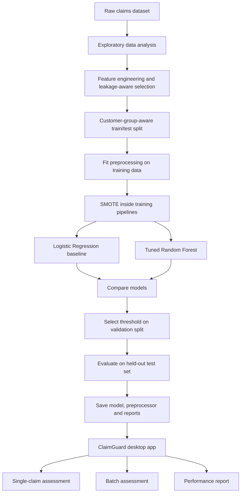

# Vehicle Insurance Claim Fraud Risk Classification System

**ClaimGuard** is a machine-learning decision-support tool that helps investigators decide which vehicle insurance claims to review first. The project compares a Logistic Regression baseline with a tuned Random Forest, then serves the final model through a desktop application for assessing single claims and ranking batches of claims.

> **Important:** ClaimGuard is an investigation-prioritisation aid, not an automated fraud detector. A high score is not proof of fraud, and a low score does not guarantee a claim is genuine. Every flagged claim requires human review.

## Contents

- [Features](#features)
- [Repository structure](#repository-structure)
- [Dataset](#dataset)
- [Methodology](#methodology)
- [Results](#results)
- [Installation](#installation)
- [Running the application](#running-the-application)
- [AI investigation assistant](#ai-investigation-assistant)
- [Reproducing the experiment](#reproducing-the-experiment)
- [Limitations and responsible use](#limitations-and-responsible-use)

## Features

**Machine learning**

- Exploratory data analysis and date-based feature engineering
- Leakage-aware feature selection
- Customer-group-aware train/test split
- Median / most-frequent imputation and one-hot encoding
- SMOTE applied inside the training pipelines
- Logistic Regression baseline and Grid-Search-tuned Random Forest
- Validation-based decision-threshold selection
- Evaluation with precision, recall, F1-score, ROC-AUC and PR-AUC

**Desktop application (PySide6)**

- **Overview:** headline model quality, most influential factors, recent assessments
- **Assess a claim:** five-step form with a risk gauge and plain-language priority
- **AI investigation assistant:** optional API-generated investigation brief with neutral verification steps; does not modify the ML prediction
- **Batch upload:** drag in a CSV, get claims ranked by risk, download the results
- **Performance:** live classification report, confusion matrix and key factors
- Light and dark themes, switchable from the top bar

The interface deliberately hides implementation details (model type, threshold, feature names). All model access goes through a separate service layer.

## Repository structure

```text
CA-1/
├── Data/
│   ├── Raw/
│   │   └── insurance_claim_fraud_dataset.csv
│   └── Processed/
│       ├── feature_names.json
│       ├── groups_test.csv
│       ├── groups_train.csv
│       ├── preprocessor.joblib
│       ├── X_test.npz
│       ├── X_train.npz
│       ├── y_test.npy
│       └── y_train.npy
├── models/
│   └── final_random_forest_fraud_model.joblib
├── reports/
│   ├── selected_threshold.json
│   ├── final_test_evaluation.csv
│   └── feature_importance.csv
├── src/
│   ├── models/
│   ├── reports/
│   ├── EDA.ipynb
│   ├── preprocessing.ipynb
│   ├── model.py
│   └── train.py
├── app.py                # desktop interface (presentation only)
├── model_service.py       # model access layer used by the interface
├── requirements.txt
└── README.md
```

`claimguard_app.py` and `model_service.py` must sit in the project root, because `model_service.py` resolves artifact paths relative to its own location.

Generated data, model and report files are excluded from version control by `.gitignore`. A fresh clone will not run the application until these artifacts have been generated or supplied (see [Required artifacts](#required-artifacts)).

## Dataset

**Source:** Kaggle, *Vehicle Insurance Claim Fraud Detection Dataset*.

The working dataset has 100,000 records and 62 columns. The target column is `fraudulent`.

| Target | Records |
|---|---:|
| No | 79,958 |
| Yes | 20,042 |

About 20% of records are labelled fraudulent.

## Methodology



### Feature engineering

Five features are derived from date fields. Invalid or impossible values are treated as missing.

| Feature | Meaning |
|---|---|
| `claim_month` | Month in which the claim occurred |
| `claim_day_of_week` | Day of the week of the claim (0 = Monday) |
| `reporting_delay_days` | Delay between the incident and the report |
| `policy_tenure_years` | How long the policy has been active |
| `vehicle_age_at_claim` | Vehicle age at the time of the claim |

### Leakage prevention

- `fraud_risk_score` is excluded because it perfectly separated the target.
- Post-decision fields (claim status, payout-related amounts) are excluded.
- Identifiers and personal names are excluded from model inputs.
- `customer_id` is kept only for group-aware splitting.
- Preprocessing is fitted on training data only.
- The test set is never used to choose the decision threshold.

### Preprocessing

| Feature type | Treatment |
|---|---|
| Numerical | Median imputation (training set) |
| Categorical | Most-frequent imputation, then one-hot encoding |
| Class imbalance | SMOTE inside the model-training pipeline |

### Train/test split

A `StratifiedGroupKFold` split groups records by `customer_id`, and the first fold is held out for testing. This gives 80,000 training and 20,000 test records, with no customer appearing in both.

### Models and tuning

- **Logistic Regression + SMOTE** is the baseline.
- **Random Forest + SMOTE** is tuned with Grid Search. Selected parameters:

| Parameter | Value |
|---|---:|
| `classifier__max_depth` | 20 |
| `classifier__max_features` | `sqrt` |
| `classifier__min_samples_leaf` | 2 |
| `classifier__n_estimators` | 250 |

### Decision threshold

A model score is turned into a flag using a threshold. The final threshold (about **0.23**) was chosen by maximising F1-score on a separate validation split of the training data. The held-out test set was evaluated only after the threshold was fixed.

## Results

### Model comparison at the default 0.50 threshold

| Model | Accuracy | Precision | Recall | F1 | ROC-AUC | PR-AUC |
|---|---:|---:|---:|---:|---:|---:|
| Logistic Regression + SMOTE | 0.6454 | 0.2476 | 0.3772 | 0.2990 | 0.5597 | 0.2503 |
| Tuned Random Forest + SMOTE | 0.8030 | 0.6736 | 0.0324 | 0.0619 | 0.6482 | 0.3617 |

### Tuned Random Forest at the selected threshold

| Threshold | Accuracy | Precision | Recall | F1 | ROC-AUC | PR-AUC |
|---:|---:|---:|---:|---:|---:|---:|
| ~0.23 | 0.6947 | 0.3364 | 0.5384 | 0.4141 | 0.6482 | 0.3617 |

At 0.50 the forest is precise but misses almost all fraud. Lowering the threshold to about 0.23 raises recall from 0.03 to 0.54 at the cost of precision. On the held-out test set the model identifies roughly 54% of fraudulent claims, and roughly 34% of the claims it flags are fraudulent. That trade-off suits an investigator-facing workflow, where suspicious claims are prioritised for review rather than rejected automatically.

### Metric guide

| Metric | Meaning |
|---|---|
| Accuracy | Share of all claims classified correctly |
| Precision | Of the claims flagged, the share that are labelled fraudulent |
| Recall | Of the claims labelled fraudulent, the share that were flagged |
| F1-score | Combined measure of precision and recall |
| ROC-AUC | How well the model ranks fraud above non-fraud across thresholds |
| PR-AUC | Precision-recall trade-off across thresholds; useful with imbalanced classes |

## Installation

Requires **Python 3.11 or newer**, **pip** and **Git**. A Kaggle account is needed to download the dataset.

```powershell
git clone https://github.com/U-Shashank-2007/Vehicle-Insurance-Claim-Fraud-Risk-Classification-System.git
cd Vehicle-Insurance-Claim-Fraud-Risk-Classification-System

python -m venv .venv
.\.venv\Scripts\Activate.ps1        # macOS/Linux: source .venv/bin/activate

python -m pip install -r requirements.txt
```

`requirements.txt` pins `scikit-learn` and `imbalanced-learn` deliberately. The saved model and preprocessor must be loaded with the same versions that created them.

Download the dataset from Kaggle and place it at:

```text
Data/Raw/insurance_claim_fraud_dataset.csv
```

## Running the application

Start from the project root:

```powershell
# Optional AI feature (PowerShell)
$env:OPENAI_API_KEY="your-real-api-key"
$env:OPENAI_MODEL="gpt-4o-mini"

python app.py
```

### AI investigation assistant

After a single-claim assessment, select **Generate AI investigation brief**.
The configured API returns a plain-language explanation and neutral record
checks for a human investigator. The AI brief can also be included in the
saved assessment CSV.

Configure `OPENAI_API_KEY` as an environment variable before starting the
application. Optional settings are `OPENAI_BASE_URL` (default:
`https://api.openai.com/v1`) and `OPENAI_MODEL` (default:
`gpt-4o-mini`). The integration supports OpenAI-compatible Chat Completions
endpoints. It uses the Python standard library; no extra package is required.

See [AI_FEATURES.md](AI_FEATURES.md) for provider configuration, privacy
minimisation, failure handling and responsible-use details. The AI feature is
optional: without a key or during an API outage, the Random Forest assessment
continues to work normally.

### Required artifacts

The application will not start without these files. If one is missing, it shows a friendly error with the details available under *Show Details*.

| File | Needed for |
|---|---|
| `models/final_random_forest_fraud_model.joblib` | Scoring (required) |
| `Data/Processed/preprocessor.joblib` | Scoring (required) |
| `reports/selected_threshold.json` | Priority levels and flags (required) |
| `reports/final_test_evaluation.csv` | Overview quality cards and chart (optional) |
| `reports/feature_importance.csv` | "What influences the scores" charts (optional) |
| `Data/Processed/test_claims.csv` | One-click report on the Performance page (optional) |

`final_test_evaluation.csv` must contain the columns `Accuracy`, `Precision`, `Recall`, `F1` and `ROC_AUC`. `feature_importance.csv` must contain `Feature` and `Importance`.

### Using the application

**Assess a claim.** Work through the five steps (Claim, Customer, Policy, Incident, Vehicle). Use only information available when the claim was first submitted; do not enter investigation outcomes. The result shows a risk score and one of three priorities: *High priority*, *Review recommended* or *Lower priority*. It can be saved as a CSV.

**Batch upload.** Use *Download template* to get the expected column layout, fill it in, then drag the CSV onto the upload area and choose *Assess all claims*. Claims are ranked from highest to lowest risk and can be downloaded. The file must contain every model input column, including the five engineered fields above. It must not contain post-investigation or post-decision information. If columns are missing, the app lists them.

**Performance report.** The application asks the model to score claims whose true outcome is known and builds a classification report from the answers: precision, recall, F1 and support per class, overall accuracy and ROC-AUC, a confusion matrix, and the most influential factors. If `Data/Processed/test_claims.csv` exists, the report runs automatically. Otherwise, choose any labelled CSV. It needs the model input columns plus a label column, which is detected automatically (`fraudulent`, `fraud`, `is_fraud` and similar), or you will be asked to pick one.

## Reproducing the experiment

1. Install dependencies and place the dataset (see [Installation](#installation)).
2. Run `src/EDA.ipynb` to inspect the data.
3. Run `src/preprocessing.ipynb` to create the files in `Data/Processed/`.
4. Run `src/train.py` (which uses `src/model.py`) to train the models and write the model, threshold and report files.
5. Check that the [required artifacts](#required-artifacts) exist, then launch the application.

If you change the preprocessing or training workflow, regenerate every artifact together so the application never mixes files from different runs.

## Limitations and responsible use

- The dataset's labels and feature distributions may not match a real insurer's claim population.
- Model performance is moderate. It does not justify automatic claim rejection or accusing anyone of fraud.
- The threshold reflects a single validation split and may not transfer to other datasets or business settings.
- SMOTE is applied after one-hot encoding, which can create fractional values in encoded categorical columns. This is a methodological limitation.
- Impurity-based Random Forest feature importance can be biased and is not causal evidence.
- The score is not a calibrated probability.
- Fairness, privacy, data quality, drift monitoring and external validation need further assessment before any real-world use.

ClaimGuard should support trained investigators only. Human review and independent evidence are required for every claim decision.

## Future work

- Claim-level explanations for individual assessments
- Probability calibration and threshold-stability checks
- Imbalance handling that preserves categorical structure
- Validation on independent, real-world data where permitted
- Investigator feedback and audit history
- Fairness and drift assessment before any deployment

## Team

Developed as a three-student academic project.

## Disclaimer

This project is for **research and educational purposes only**.